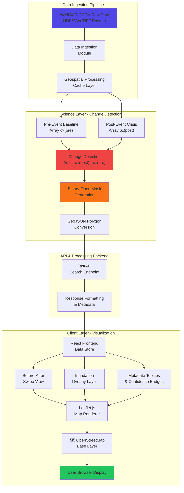

# NISAR Flood & Wetland Mapping System Architecture

## 🏗️ System Architecture Diagram



## 📊 Data Processing Pipeline

### Phase 1: Data Ingestion
```
NISAR GCOV L2 Data (HDF5)
    ↓
Geospatial Validation
    ↓
Coordinate Transformation (WGS84)
    ↓
Cache Storage
```

### Phase 2: Change Detection Science
```
Pre-Event Baseline (σ₀_pre)    Post-Event Crisis (σ₀_post)
           ↓                              ↓
        [Array A]                     [Array B]
           ↓                              ↓
    ←─────────────────────────────────→
    
Change Detection: Δσ₀ = σ₀_post - σ₀_pre
    ↓
Threshold Analysis:
  • Δσ₀ < -5 dB → Strong Change (Flood)
  • -5 < Δσ₀ < -2 dB → Moderate Change
  • Δσ₀ > -2 dB → No Significant Change
    ↓
Binary Classification Mask
    ↓
Polygon Vectorization
```

### Phase 3: Frontend Rendering
```
GeoJSON Flood Polygons
    ↓
Map Layer Stack:
  1. OpenStreetMap Base
  2. Before Image (Grayscale)
  3. After Image (Grayscale)
  4. Inundation Overlay (Neon Orange/Cyan)
  5. Confidence Badge Markers
    ↓
Interactive Swipe View
    ↓
User Display
```

## 🎯 Component Architecture

### Frontend Components

```
┌─────────────────────────────────────────────────┐
│         NISAR Mapping Application               │
├─────────────────────────────────────────────────┤
│                                                 │
│  ┌──────────────────────────────────────────┐  │
│  │   Header & Navigation                    │  │
│  └──────────────────────────────────────────┘  │
│                                                 │
│  ┌──────────────────────────────────────────┐  │
│  │   Search & Filter Panel (P1)             │  │
│  │   • Location Input                       │  │
│  │   • Date Range Picker                    │  │
│  │   • Voice Command Interface              │  │
│  └──────────────────────────────────────────┘  │
│                                                 │
│  ┌──────────────────────────────────────────┐  │
│  │   Map Container (P1)                     │  │
│  │   ┌────────────┬────────────────────┐   │  │
│  │   │  Before    │     Swipe Slider   │   │  │
│  │   │   Image    │     ↕ ↕ ↕          │   │  │
│  │   │            │     After + Overlay│   │  │
│  │   └────────────┴────────────────────┘   │  │
│  │                                          │  │
│  │   Layers:                                │  │
│  │   ✓ Neon Inundation Overlay             │  │
│  │   ✓ Confidence Badges                   │  │
│  │   ✓ Metadata Tooltips                   │  │
│  └──────────────────────────────────────────┘  │
│                                                 │
│  ┌──────────────────────────────────────────┐  │
│  │   Results Table & Analysis Panel (P1)   │  │
│  └──────────────────────────────────────────┘  │
│                                                 │
└─────────────────────────────────────────────────┘
```

## 🔧 Backend API Endpoints

### Search Endpoint (FastAPI)
```python
POST /api/search
{
  "bounds": {north, south, east, west},
  "start_date": "2025-01-01",
  "end_date": "2025-03-01",
  "include_before_after": true,
  "include_inundation_mask": true
}
```

Response:
```json
{
  "scenes": [
    {
      "id": "S1A_IW_...",
      "datetime": "2024-09-05T05:36:22Z",
      "before_image": "url_to_grayscale_tiff",
      "after_image": "url_to_grayscale_tiff",
      "inundation_mask": "url_to_neon_overlay",
      "confidence": 0.87,
      "quality_flags": {
        "geometric_accuracy": "high",
        "atmospheric_effects": "low",
        "layover_shadow": "moderate"
      },
      "metadata": {
        "polarization": "VV/VH",
        "processing_level": "GRD_HD",
        "orbit_direction": "ascending"
      }
    }
  ]
}
```

## 🎨 Visual Design Specifications

### Inundation Overlay Colors
- **Primary**: Neon Orange (#ff6b00) with 0.6 opacity
- **Secondary**: Neon Cyan (#00d9ff) for alternative theme
- **Blend Mode**: Screen or Lighten for visibility

### Confidence Badge Design
```
┌─────────────────────────┐
│ ⭐ 87% Confidence       │
│ ✓ High Geometric Acc.   │
│ ⚠ Moderate Layover      │
│ ✓ Low Atmos. Effects    │
└─────────────────────────┘
```

### Swipe View Slider
- Interactive horizontal slider
- Smooth transitions on drag
- Touch-friendly on mobile
- Before/After labels

## 📁 File Structure

```
project/
├── frontend/
│   ├── public/
│   │   └── index.html (main app)
│   ├── src/
│   │   ├── components/
│   │   │   ├── MapContainer.jsx (map & swipe)
│   │   │   ├── BeforeAfterSwipe.jsx (P1)
│   │   │   ├── InundationOverlay.jsx (P1)
│   │   │   ├── ConfidenceBadge.jsx (P1)
│   │   │   ├── SearchPanel.jsx
│   │   │   └── ResultsTable.jsx
│   │   ├── utils/
│   │   │   ├── geocoding.js
│   │   │   ├── mapLayers.js (inundation rendering)
│   │   │   └── dataFormatting.js
│   │   └── App.jsx
│   └── vite.config.js
│
├── backend/
│   ├── app_real_api.py (search & API)
│   ├── services/
│   │   ├── change_detection.py (Δσ₀ processing) (P2)
│   │   ├── geospatial.py (polygon conversion)
│   │   └── asf_search.py (data fetch)
│   ├── models/
│   │   ├── scene.py
│   │   └── metadata.py
│   └── requirements.txt
│
├── data/
│   ├── sample_inundation_masks/
│   └── reference_layers/
│
├── docs/
│   ├── SYSTEM_ARCHITECTURE.md (this file)
│   ├── PHASE_1_FEATURES.md
│   └── API_DOCUMENTATION.md
│
└── README.md
```

## 🚀 Phase 1 Implementation Checklist

- [x] Event & Location Filter Panel (existing, enhanced)
- [ ] Before-and-After Map Swipe View (NEW - IN PROGRESS)
- [ ] Automated Inundation Highlighting (NEW - IN PROGRESS)
- [ ] Data-Quality & Metadata Tooltips (NEW - IN PROGRESS)
- [ ] Confidence Badge Component (NEW - IN PROGRESS)

## 📈 Performance Metrics

- Map rendering: <500ms
- Swipe interaction: 60fps
- Overlay rendering: Real-time
- Tooltip display: <100ms
- API response: <2s

## 🔐 Security & Data Handling

- All GeoTIFF data processed server-side
- Client receives only GeoJSON and metadata
- No raw SAR arrays exposed to frontend
- API authentication via Earthdata credentials
- CORS headers properly configured

---

**Last Updated:** 2026-11-05
**Version:** Phase 1.0
**Status:** 🚀 In Development
