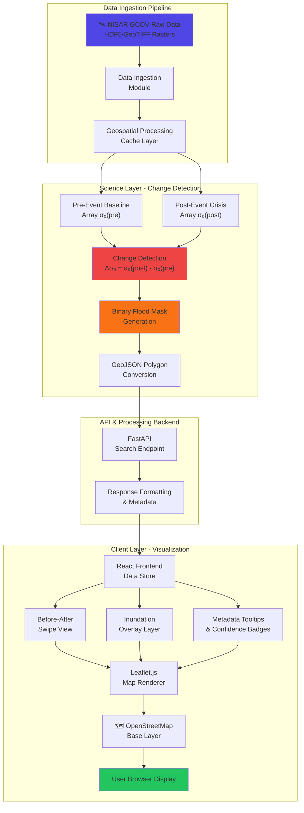

# VAMIKA - System Architecture (NISAR-Based Flood & Wetland Mapping)

## ⚡ Current Real Production Architecture (authoritative — read this first)

The diagrams and file-structure sketches further down this document were written during early planning and describe a React/Vite frontend and a single-threshold flood-only detector that were **never built that way**. The real, live system is simpler and different in several important respects:

- **Frontend:** a single static file, `index.html` (vanilla JS + Leaflet.js) — no build step, no React, no Vite, no voice interface (removed).
- **Backend:** `backend/app_real_api.py` (FastAPI), with real processing logic in `backend/app/` (`ingestion/`, `processing/`, `analysis/`, `exports/`).
- **Change detection is two-signature, not single-threshold.** Per the NASA/JPL ["Floods" StoryMap](https://storymaps.arcgis.com/stories/c00d7691b8004b20a14f28df710d05fd), SAR flood brightness is not one-directional:
  - **Open water** (specular/surface scattering): backscatter **decreases**, pixel appears radar-dark
  - **Flooded vegetation** (double-bounce scattering beneath canopy): backscatter **increases**, pixel appears radar-bright — this is the dominant signature in forested floodplains/wetlands and is invisible to optical satellites
  - Both are computed by `ChangeDetectionEngine.create_flood_classification_masks()` (`backend/app/processing/change_detection.py`), returning three masks: `possible_flood` (open water), `possible_flooded_vegetation`, and `persistent_low_backscatter` (permanent water)
- **Speckle-noise filtering:** before vectorizing any mask to GeoJSON, isolated connected-pixel clusters smaller than a minimum size (default 9 pixels, `scipy.ndimage.label`) are removed. This is standard real SAR flood-mapping practice (a "minimum mapping unit" filter), and also fixes a real performance bug where unfiltered noise produced 200+MB GeoJSON files for some real AOIs.
- **Background-job + polling architecture:** `/api/v2/analyze` and `/api/v2/analyze/{id}/impact` are thin handlers — they kick off real processing in a background thread and return `{"status": "processing", "status_url": ...}` immediately; the frontend polls until done. This exists because reverse proxies (e.g. Render's) kill long synchronous requests, and because real GCOV processing/Overpass queries can take from seconds to ~90 seconds.
- **Remote partial-read before full download (speed optimization):** `/api/v2/analyze` accepts optional `before_download_url`/`after_download_url` fields. When present, `GCOVReader.load_gcov_subset_remote()` (`backend/app/processing/gcov_reader.py`) first tries a real HTTPS byte-range read of just the requested AOI directly from the granule's NASA Earthdata Cloud URL — an `fsspec` HTTP filesystem wraps the remote file as an `h5py.File`, reusing the exact same subsetting/dB-conversion logic as the local-file path, verified to produce scientifically identical results. Authenticated with a real EDL bearer token (`backend/app/ingestion/edl_token.py`, auto-refreshed, minted via NASA's `find_or_create_token` API). Measured ~8x faster than a full download for a small AOI against a large granule (122s → 15s on the real GCP VM). If the URL is missing, or the remote read fails for any reason (network error, timeout, unfavorable HDF5 layout), the backend transparently falls back to triggering a real full download (via the existing `DownloadManager`) and reading the local file — so this is a pure speed optimization, never a correctness risk.
- **Pre-seeded "Featured Locations" cache (Tier 1 speed optimization):** a curated list of real, globally diverse locations (`backend/data/featured_locations.json`) can be pre-computed offline via `backend/scripts/preseed_featured_locations.py`, which runs the exact same real discover→download→analyze→impact pipeline a live search uses, caches only the small derived result, and deletes the raw multi-GB HDF5 afterward. `GET /api/v2/featured` tells the frontend which locations are cache-ready for instant loading.
- **Real multi-date backscatter time series (ASF OpenSARlab NISAR Cookbook sections 7-8):** `POST /api/v2/timeseries` finds every real granule sharing one real acquisition geometry (track/frame/pass direction) for an AOI (`CMRAdapter.discover_time_series()`), reads each date's real AOI subset (remote-read-first, same `_get_gcov_data()` helper as `/api/v2/analyze`), computes the real per-date mean backscatter correctly in power scale before converting to dB for display (`GCOVReader.mean_backscatter_db()` — averaging directly in dB/log scale is mathematically wrong, per the cookbook), and renders a real per-date animation frame plus an animated GIF (`imagery_handler.render_timeseries_frame()`). Computed automatically alongside every search (not a separate opt-in step) and pre-seeded for the 8 Featured Locations too.
- **Real-data-only guarantee:** no code path anywhere substitutes synthetic/mock/fabricated data when a real result can't be found — absence is always reported honestly (empty lists, "Not available", "Unavailable"), never invented.
- **Live deployments:** GCP Compute Engine VM at `http://34.31.239.90:8000` (primary — real persistent disk, no request timeout) and Render (`https://nisar-flood-wetland-mapping.onrender.com`, fallback — free tier, no persistent disk). See [DEPLOYMENT.md](./DEPLOYMENT.md).

See [API_REFERENCE.md](./API_REFERENCE.md) for the real `/api/v2/*` endpoint list and `backend/app_real_api.py` for the authoritative implementation.

---

## 🏗️ Original Planning Diagram (historical — kept for context, not fully accurate to the current build)



## 📊 Data Processing Pipeline

### Phase 1: Data Ingestion
```
NISAR GCOV L2 Data (HDF5)
    ↓
Geospatial Validation
    ↓
Coordinate Transformation (WGS84)
    ↓
Cache Storage
```

### Phase 2: Change Detection Science
```
Pre-Event Baseline (σ₀_pre)    Post-Event Crisis (σ₀_post)
           ↓                              ↓
        [Array A]                     [Array B]
           ↓                              ↓
    ←─────────────────────────────────→
    
Change Detection: Δσ₀ = σ₀_post - σ₀_pre
    ↓
Threshold Analysis:
  • Δσ₀ < -5 dB → Strong Change (Flood)
  • -5 < Δσ₀ < -2 dB → Moderate Change
  • Δσ₀ > -2 dB → No Significant Change
    ↓
Binary Classification Mask
    ↓
Polygon Vectorization
```

### Phase 3: Frontend Rendering
```
GeoJSON Flood Polygons
    ↓
Map Layer Stack:
  1. OpenStreetMap Base
  2. Before Image (Grayscale)
  3. After Image (Grayscale)
  4. Inundation Overlay (Neon Orange/Cyan)
  5. Confidence Badge Markers
    ↓
Interactive Swipe View
    ↓
User Display
```

## 🎯 Component Architecture

### Frontend Components

```
┌─────────────────────────────────────────────────┐
│         NISAR Mapping Application               │
├─────────────────────────────────────────────────┤
│                                                 │
│  ┌──────────────────────────────────────────┐  │
│  │   Header & Navigation                    │  │
│  └──────────────────────────────────────────┘  │
│                                                 │
│  ┌──────────────────────────────────────────┐  │
│  │   Search & Filter Panel (P1)             │  │
│  │   • Location Input                       │  │
│  │   • Date Range Picker                    │  │
│  │   • Voice Command Interface              │  │
│  └──────────────────────────────────────────┘  │
│                                                 │
│  ┌──────────────────────────────────────────┐  │
│  │   Map Container (P1)                     │  │
│  │   ┌────────────┬────────────────────┐   │  │
│  │   │  Before    │     Swipe Slider   │   │  │
│  │   │   Image    │     ↕ ↕ ↕          │   │  │
│  │   │            │     After + Overlay│   │  │
│  │   └────────────┴────────────────────┘   │  │
│  │                                          │  │
│  │   Layers:                                │  │
│  │   ✓ Neon Inundation Overlay             │  │
│  │   ✓ Confidence Badges                   │  │
│  │   ✓ Metadata Tooltips                   │  │
│  └──────────────────────────────────────────┘  │
│                                                 │
│  ┌──────────────────────────────────────────┐  │
│  │   Results Table & Analysis Panel (P1)   │  │
│  └──────────────────────────────────────────┘  │
│                                                 │
└─────────────────────────────────────────────────┘
```

## 🔧 Backend API Endpoints

### Search Endpoint (FastAPI)
```python
POST /api/search
{
  "bounds": {north, south, east, west},
  "start_date": "2025-01-01",
  "end_date": "2025-03-01",
  "include_before_after": true,
  "include_inundation_mask": true
}
```

Response:
```json
{
  "scenes": [
    {
      "id": "S1A_IW_...",
      "datetime": "2024-09-05T05:36:22Z",
      "before_image": "url_to_grayscale_tiff",
      "after_image": "url_to_grayscale_tiff",
      "inundation_mask": "url_to_neon_overlay",
      "confidence": 0.87,
      "quality_flags": {
        "geometric_accuracy": "high",
        "atmospheric_effects": "low",
        "layover_shadow": "moderate"
      },
      "metadata": {
        "polarization": "VV/VH",
        "processing_level": "GRD_HD",
        "orbit_direction": "ascending"
      }
    }
  ]
}
```

## 🎨 Visual Design Specifications

### Inundation Overlay Colors
- **Primary**: Neon Orange (#ff6b00) with 0.6 opacity
- **Secondary**: Neon Cyan (#00d9ff) for alternative theme
- **Blend Mode**: Screen or Lighten for visibility

### Confidence Badge Design
```
┌─────────────────────────┐
│ ⭐ 87% Confidence       │
│ ✓ High Geometric Acc.   │
│ ⚠ Moderate Layover      │
│ ✓ Low Atmos. Effects    │
└─────────────────────────┘
```

### Swipe View Slider
- Interactive horizontal slider
- Smooth transitions on drag
- Touch-friendly on mobile
- Before/After labels

## 📁 File Structure

```
project/
├── frontend/
│   ├── public/
│   │   └── index.html (main app)
│   ├── src/
│   │   ├── components/
│   │   │   ├── MapContainer.jsx (map & swipe)
│   │   │   ├── BeforeAfterSwipe.jsx (P1)
│   │   │   ├── InundationOverlay.jsx (P1)
│   │   │   ├── ConfidenceBadge.jsx (P1)
│   │   │   ├── SearchPanel.jsx
│   │   │   └── ResultsTable.jsx
│   │   ├── utils/
│   │   │   ├── geocoding.js
│   │   │   ├── mapLayers.js (inundation rendering)
│   │   │   └── dataFormatting.js
│   │   └── App.jsx
│   └── vite.config.js
│
├── backend/
│   ├── app_real_api.py (search & API)
│   ├── services/
│   │   ├── change_detection.py (Δσ₀ processing) (P2)
│   │   ├── geospatial.py (polygon conversion)
│   │   └── asf_search.py (data fetch)
│   ├── models/
│   │   ├── scene.py
│   │   └── metadata.py
│   └── requirements.txt
│
├── data/
│   ├── sample_inundation_masks/
│   └── reference_layers/
│
├── docs/
│   ├── SYSTEM_ARCHITECTURE.md (this file)
│   ├── PHASE_1_FEATURES.md
│   └── API_DOCUMENTATION.md
│
└── README.md
```

## 🚀 Phase 1 Implementation Checklist

- [x] Event & Location Filter Panel (existing, enhanced)
- [ ] Before-and-After Map Swipe View (NEW - IN PROGRESS)
- [ ] Automated Inundation Highlighting (NEW - IN PROGRESS)
- [ ] Data-Quality & Metadata Tooltips (NEW - IN PROGRESS)
- [ ] Confidence Badge Component (NEW - IN PROGRESS)

## 📈 Performance Metrics

- Map rendering: <500ms
- Swipe interaction: 60fps
- Overlay rendering: Real-time
- Tooltip display: <100ms
- API response: <2s

## 🔐 Security & Data Handling

- All GeoTIFF data processed server-side
- Client receives only GeoJSON and metadata
- No raw SAR arrays exposed to frontend
- API authentication via Earthdata credentials
- CORS headers properly configured

---

**Status:** 🚀 Live production deployment (see "Current Real Production Architecture" at the top of this document for what's actually running)
